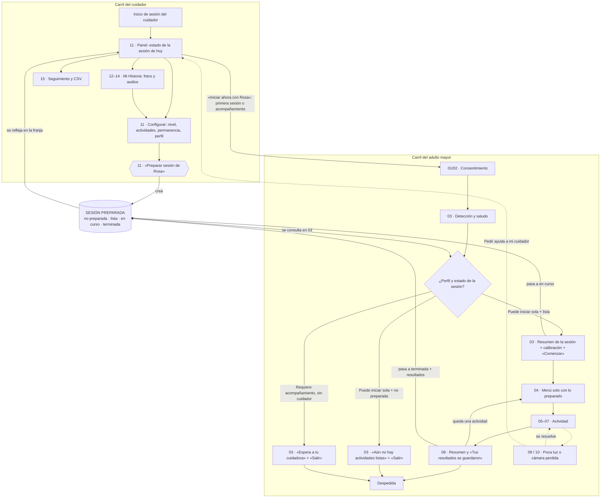

# Mente en Movimiento — Separación de interfaces y sesión híbrida

## Punto 1 — Separación de interfaces

### 1.1 Por qué deben ser dos interfaces

Las dos personas que usan el sistema tienen tareas distintas. **El cuidador decide** (qué se practica, a qué dificultad y con qué fotos) y **revisa** cómo le fue a la persona. **El adulto mayor practica**. Si una sola interfaz atiende a los dos, alguno de ellos termina usando algo que no fue hecho para él:

- **Para el adulto mayor (74–79 años) cada elemento de más cuesta.** Elige con la mano o la mirada dejando el cursor quieto 1,5–2,5 s. Todo lo que aparece en pantalla es un posible objetivo y un posible error. Un selector de nivel o una casilla puede activarse por accidente durante la permanencia y cambiar la configuración sin que nadie lo note.
- **La información técnica se lee como un juicio.** «Nivel: Fácil», «confianza 87 %» o «2 reintentos» le dicen a la persona que la están evaluando. Eso va contra el tono de logro del prototipo («¡Gran trabajo, Rosa!», «Casi lo logras») y puede llevar a que deje de usarlo.
- **El cuidador necesita densidad y precisión.** Pide cifras, historial, exportar CSV y edición con mouse y teclado. Si su vista se adapta al adulto mayor (texto de 24 px, botones enormes, narración por voz), se vuelve lenta e incómoda.
- **Seguridad.** Si el adulto mayor puede cambiar el nivel o habilitar actividades, el control del cuidador desaparece. También deja de tener sentido el ajuste automático de dificultad, que se calcula con sesiones hechas bajo condiciones conocidas.

**Qué pasa si se mezclan:**

- Habría cambios de configuración por accidente durante la permanencia.
- La persona se sentiría evaluada.
- Aparecerían opciones que no sirven, como «Coordinación deshabilitada» en el menú 04.
- Las sesiones dejarían de ser comparables en el seguimiento (15).

### 1.2 Qué va en cada interfaz

| Elemento | Cuidador (11–15, Configuración) | Adulto mayor (01–10) |
|---|---|---|
| Selector de nivel o dificultad | ✅ | ❌ Nunca |
| Recomendación del modelo de IA y su confianza | ✅ | ❌ Nunca |
| Casillas de actividades habilitadas | ✅ | ❌ Nunca |
| Tiempo de permanencia, puntero (mano, mirada, voz), movilidad | ✅ | ❌ Nunca |
| Subir, editar o borrar fotos y audios de Mi Historia (12–14) | ✅ | ❌ Nunca. Solo ve las fotos dentro de la actividad |
| Seguimiento, gráficos, aciertos por sesión, reintentos, tiempos (15) | ✅ | ❌ Nunca |
| Exportar CSV | ✅ | ❌ Nunca |
| Datos técnicos (calibración, alcance, estado del WebSocket, mensajes de error de la API) | ✅ Si hacen falta para diagnosticar | ❌ Nunca. Se traducen a mensajes humanos (09, 10) |
| «Preparar sesión» y estado de la sesión | ✅ | ❌ Solo ve el resultado: «Tu sesión de hoy está lista» |
| Saludo personalizado, consentimiento (01/02), calibración guiada (03) | — | ✅ |
| Tarjetas de las actividades preparadas para hoy (04) | — | ✅ |
| Progreso de la sesión en lenguaje de logro («1 de 2 actividades hechas») | Lo ve como dato | ✅ |
| Resumen positivo (08), sin la palabra «errores» y sin nivel | — | ✅ |
| «Pedir ayuda a mi cuidador» | Recibe el aviso | ✅ |

**Corrección concreta en el prototipo actual:** quitar la insignia `Nivel: {NOMBRE_NIVEL[...]}` del menú 04 ([Menu.jsx:66](../frontend/src/adulto/Menu.jsx#L66)). El nivel se sigue usando por dentro para generar los ítems, pero la persona no lo ve.

### 1.3 Qué hacer con «Coordinación deshabilitada» en el menú del adulto mayor

Hay tres opciones posibles:

| Opción | Lo bueno | Lo malo |
|---|---|---|
| **a. Ocultar la tarjeta** | Menú más limpio y menos objetivos para la permanencia | Si la persona se acuerda de que «antes estaba», puede pensar que algo se rompió |
| **b. Tarjeta bloqueada con candado** y «Pídele a tu cuidador que la active» | Explica por qué no está | Es un objetivo que no lleva a ningún lado. Con la permanencia, la persona puede quedarse 2 s sobre ella esperando que haga algo. Además ocupa espacio en una rejilla de 4 |
| **c. Ocultarla del menú y explicarlo una sola vez, fuera del menú** | Une lo mejor de a y b | Hay que guardar un dato extra («ya se avisó») |

**Recomendación: opción c.**

- **En el menú 04 nunca aparece una tarjeta que no se puede usar.** Es lo que ya hace el código como ajuste de la prueba de usabilidad. Así se cumple la regla de que todo lo que se ve se puede elegir.
- **El aviso va en el resumen de la sesión preparada (pantalla 03).** Si el cuidador quitó una actividad que la persona hizo en alguna de sus últimas 3 sesiones, el aviso lo dice como texto informativo, no como botón: «Hoy no toca Coordinación. Si quieres hacerla, pídesela a tu cuidadora.»
- **Tarjeta con candado solo como excepción.** Se usa si el cuidador marca en el panel la opción «Mostrarle las actividades bloqueadas», pensada para usuarios que preguntan por ellas. En ese caso la tarjeta **no tiene `data-elegible`**: la permanencia no la toma, no se ilumina y no se puede pulsar. Lleva un candado de 48 px, fondo blanco, borde punteado `--borde` y texto `--gris` (contraste 8,7:1, no un gris débil).

---

## Punto 2 — Quién inicia la sesión

### 2.1 Comparación

| | **A. Solo el cuidador inicia** | **B. Solo el paciente inicia, libremente** | **C. Híbrido: el cuidador prepara y habilita, el paciente inicia dentro de ese marco** |
|---|---|---|---|
| **Ventaja principal** | Control total. Cada sesión empieza con las condiciones correctas (luz, postura, calibración) | Máxima autonomía. La persona practica cuando quiere, sin depender de nadie | La persona decide **cuándo** empieza y, dentro de lo preparado, **en qué orden**. El cuidador decide **qué** y **a qué dificultad**. Él no tiene que estar presente |
| **Problema principal** | El adulto mayor depende de la agenda del cuidador. Se practica menos (solo cuando coinciden) y la persona queda en un rol pasivo | Nadie controla el contenido ni la dificultad. La persona puede quedar sin actividades útiles o repetir siempre la misma. Además, si se equivoca de camino, está sola | Hay que mantener un estado más (la «sesión preparada») y explicarle a la persona por qué a veces no hay nada listo |
| **Perfil adecuado** | Deterioro cognitivo moderado a avanzado, o primera vez con la tecnología | Adulto mayor sin deterioro, con experiencia digital y sin cuidador | Adulto mayor de 74–79 años con deterioro leve o sin deterioro, que puede sentarse y seguir indicaciones solo, con un cuidador que no vive con él o trabaja |

### 2.2 Recomendación: opción C (híbrida)

Para este perfil y con lo que mostró la prueba de usabilidad, la opción C es la que funciona:

1. **Lo que confunde a la persona es la configuración, no el empezar a jugar.** Los hallazgos (la tarjeta deshabilitada visible, el nivel a la vista, el botón secundario poco diferenciado) vienen de que el adulto mayor vio cosas del cuidador. Con C, toda la configuración pasa a la pantalla 11. La persona solo tiene que tomar una decisión: «Comenzar».
2. **La autonomía hace que la persona vuelva.** A los 74–79 años, poder decidir cuándo practicar aumenta la adherencia. La opción A convierte el ejercicio en una cita más que depende de otra persona.
3. **El ajuste automático de dificultad necesita condiciones estables.** El modelo (exactitud 94,3 %) recomienda subir, mantener o bajar a partir de sesiones comparables. Con B no hay un marco común. Con C, el cuidador confirma o corrige el nivel al preparar la sesión, así que la última palabra la tiene una persona.
4. **Seguridad sin vigilancia.** Si algo falla (09 o 10), la persona no queda sola: «Pedir ayuda a mi cuidador» avisa en el panel. El cuidador no tiene que estar al lado, pero se entera.

### 2.3 Dos excepciones: el cuidador inicia directamente

| Excepción | Por qué | Cómo funciona |
|---|---|---|
| **Primera sesión (con calibración)** | La persona todavía no sabe que se elige dejando la mano quieta. La calibración guiada (llevar la mano arriba, derecha, abajo, izquierda) o la de mirada (9 puntos) necesita a alguien que la explique y que pueda pulsar «Omitir» con el mouse si algo no funciona | Toda persona nueva empieza como «Requiere acompañamiento». La primera sesión siempre la inicia el cuidador desde la pantalla 11 |
| **Deterioro cognitivo avanzado** | La persona no podría interpretar «Tu cuidadora dejó lista tu sesión» ni recuperarse sola de un error | El cuidador lo fija en el perfil y siempre inicia él |

**Cómo se resuelve: un campo «perfil de usuario» en la pantalla 11**, en el bloque de configuración:

> **¿Cómo empieza sus sesiones?**
> ◉ **Puede iniciar sola** — Tú preparas la sesión y ella la empieza cuando quiera.
> ○ **Requiere acompañamiento** — Tú inicias la sesión y te quedas a su lado.

Reglas:

- **Valor inicial:** «Requiere acompañamiento».
- **Sugerencia de cambio:** cuando termina la primera sesión con 6 o más aciertos de 8 y sin pedidos de ayuda, el panel sugiere: «Rosa completó su primera sesión sin ayuda. ¿Quieres que pueda empezar sola?» con los botones **[Sí, puede sola]** **[Todavía no]**. Nunca cambia solo.
- **Con «Requiere acompañamiento»:** el botón principal de la pantalla 11 es **«Iniciar ahora con Rosa»**, que reemplaza a «Ver como Rosa» y lleva a 01/02 → 03. Si la persona se sienta sola frente a la cámara, la pantalla 03 dice: «Hola, Rosa. Espera a tu cuidadora para empezar.» con un solo botón **«Salir»**.

---

## Punto 3 — Flujo híbrido concreto

### 3.A Cuidador (amplía la pantalla 11)

**Paso 1 — Entra al panel (11).** Inicia sesión y llega a «Hola, Marta». Las tres cifras de arriba (última sesión, aciertos, nivel actual) no cambian. **Encima de ellas** aparece una franja nueva de **estado de la sesión de hoy** (ver paso 4). Es lo primero que lee, porque responde lo que el cuidador viene a saber: «¿Rosa tiene su sesión lista?».

**Paso 2 — Configura.** Todo en el bloque izquierdo de la pantalla 11, en este orden:

1. **Nivel de dificultad.** Es el segmentado actual Fácil / Medio / Difícil, junto con la recomendación del modelo y su confianza.
2. **Actividades de hoy.** Las casillas actuales pasan a ser interruptores con el nombre y la descripción de cada actividad. Tiene que haber al menos 1 y, para cumplir la meta diaria, se sugieren 2.
3. **Tiempo de permanencia.** Hoy está en Configuración y pasa también al panel como segmentado 1,5 / 2 / 2,5 s, porque es lo que el cuidador más ajusta según cómo vio a la persona. Si el puntero es «La mirada», se preselecciona 2 s y aparece la nota «Con la mirada recomendamos 2 o 2,5 s».
4. **Mi Historia.** Una línea de resumen: «12 fotos y 3 audios · última foto subida el 8 de nov.», con un enlace a «Elegir fotos (12–14)». Solo aparece si Mi Historia está activa.
5. **Perfil de usuario.** «Puede iniciar sola» / «Requiere acompañamiento» (Punto 2.3).

**Paso 3 — «Preparar sesión de Rosa».** Es el **único botón principal** de la pantalla 11 y reemplaza a «Guardar cambios» como acción principal. Con un solo clic:

- guarda el nivel, las actividades, la permanencia y el perfil (`PATCH /api/pacientes/{id}/`);
- crea la sesión preparada del día con esas actividades;
- muestra el aviso flotante «Listo. Rosa ya puede empezar cuando quiera.».

Validaciones antes de preparar. Los mensajes van junto al botón, no en una ventana:

- Si no hay ninguna actividad activa: «Elige al menos una actividad para preparar la sesión.»
- Si Mi Historia está activa y no tiene fotos: «Mi Historia no tiene fotos todavía. Sube alguna o quítala de hoy.»

«Guardar cambios» queda como botón secundario, para quien quiere ajustar algo sin dejar una sesión lista. El diálogo de «cambios sin guardar» se mantiene.

**Paso 4 — Ve el estado de la sesión.** La franja de estado tiene cuatro estados. Cada uno tiene un ícono, un color y un texto distintos, para no depender solo del color:

| Estado | Franja | Botón en la franja |
|---|---|---|
| **No preparada** | Crema `--crema` · reloj · «Hoy no hay sesión preparada para Rosa.» | «Preparar sesión de Rosa» (lleva al bloque de configuración) |
| **Lista** | Menta `--menta` · check · «Sesión lista: Memoria y Mi Historia · Fácil · preparada a las 8:40.» | «Cambiar» (vuelve a editar la configuración) |
| **En curso** | Verde `--verde-oscuro` con texto blanco · punto que late · «Rosa está haciendo su sesión · 1 de 2 actividades.» | — (no se puede editar mientras está en curso) |
| **Terminada** | Hielo `--hielo` · bandera · «Rosa terminó a las 10:15 · 7 de 8 aciertos.» | «Ver seguimiento» (15) · «Preparar otra» |

Si hubo un pedido de ayuda, encima de cualquier estado aparece un aviso rojo `--rojo-claro` con borde `--rojo`: «Rosa pidió ayuda a las 9:52 · Se desconectó la cámara.» con el botón **«Entendido»**.

Una sesión preparada vale **hasta las 23:59 de ese día** y se puede hacer una vez. Al día siguiente vuelve a «No preparada», para que la persona no practique con una configuración vieja.

**Paso 5 — El cuidador se va.** Nada del flujo del adulto mayor necesita al cuidador. Puede cerrar el navegador.

**Paso 6 (opcional) — Aviso al terminar.** En la pantalla 11, la casilla «Avisarme en este equipo cuando Rosa termine» manda una notificación del navegador: **«Rosa terminó su sesión · 7 de 8 aciertos.»** Los pedidos de ayuda se notifican siempre y quedan en la franja roja del panel, aunque la casilla esté apagada. *(Implementado: el panel revisa el estado cada 15 s mientras está abierto. El aviso por correo quedaría para una versión con servidor de correo.)*

### 3.B Adulto mayor (amplía las pantallas 03–04)

**Paso 1 — Se sienta frente a la cámara.** Primero aparece el consentimiento (01/02), igual que ahora.

**Paso 2 — Pantalla 03: lo detecta y lo saluda.** «¡Hola, Rosa! Ya te vemos.» con narración por voz. Antes de pedirle que calibre, el sistema revisa el estado de la sesión y el perfil.

**Paso 3 — Hay sesión preparada (pantalla 03, estado «sesión lista»).**

- Panel lateral: «¡Hola, Rosa!».
- Centro: una tarjeta con el resumen: **«Tu cuidadora dejó lista tu sesión de hoy: Memoria y Mi Historia.»** Aquí **no** se muestra el nivel: el «Nivel Fácil» que pedía el enunciado se omite a propósito por el Punto 1.2. Debajo, los íconos de las dos actividades (72 px) con sus nombres.
- La calibración guiada sigue igual (mano o mirada).
- Al terminar la calibración aparece **un solo botón principal: «Comenzar»**, que se elige dejando el cursor quieto. Usa la permanencia configurada, nunca menos de 1,5 s, con el anillo que se va llenando.
- Al elegirlo, la sesión pasa a **En curso** en el panel y se abre el **menú 04**, que muestra **solo las actividades preparadas**. La persona elige el orden.
- Las actividades terminadas quedan con un check y «Hecha». Cuando no queda ninguna, el menú lleva directo al cierre.

**Paso 4 — No hay sesión preparada (pantalla 03, estado «sin sesión»).**

- Se **salta la calibración**. Para un solo botón grande alcanza con la estimación por hombros, así la persona no hace un esfuerzo para nada.
- Mensaje: **«Aún no hay actividades listas para hoy. Pídele a tu cuidadora que las prepare.»**
- Un solo botón: **«Salir»**, que lleva a la despedida que ya existe («¡Hasta pronto, Rosa!»).
- Si el perfil es «Requiere acompañamiento», el mensaje es: «Hola, Rosa. Espera a tu cuidadora para empezar.»

**Paso 5 — Actividades deshabilitadas.** No aparecen en el menú 04 (opción c del Punto 1.3). El candado sale solo si el cuidador lo activó, y nunca se puede elegir.

**Paso 6 — «Pedir ayuda a mi cuidador» en las pantallas de error.**

| Pantalla | Botón principal | Botón secundario | Qué pasa |
|---|---|---|---|
| **09 · Poca luz** | «Ya hay más luz» (se mantiene «Reintentar») | «Pedir ayuda a mi cuidador» | Avisa en el panel y la pantalla cambia a «Ya le avisamos a tu cuidadora. Puedes esperar aquí tranquila.» |
| **10 · Cámara o conexión perdida** | — (la reconexión es automática) | — | **Sin cámara, la persona no puede elegir nada con la mano.** Por eso el pedido de ayuda se manda **solo** si la cámara no vuelve en 30 s, y la pantalla lo muestra: «Ya le avisamos a tu cuidadora.» Si «Elegir también con la voz» está activo, decir «ayuda» hace lo mismo antes de los 30 s |
| **05 · «No pudimos empezar»** | «Pedir ayuda a mi cuidador» | «Volver al menú» | Igual que en 09 |

**Paso 7 — Al terminar (pantalla 08).**

- Se mantiene «¡Gran trabajo, Rosa!» con el resultado en positivo («Acertaste 7»). No se muestran errores ni nivel.
- Se agrega la línea: **«Tus resultados se guardaron para que tu cuidadora los vea.»**
- Un solo botón principal: **«Terminar»**. Si todavía queda una actividad preparada, el principal es «Seguir con Mi Historia».
- En el panel, la sesión pasa a **Terminada** y se manda el aviso del Paso 6 del cuidador.

---

## Entregable 3 — Mapa de navegación (Mermaid)



---

## Entregable 4 — Wireframes clave (descripción)

### Pantalla 11 ampliada — Panel del cuidador

```
┌──────────────────────────────────────────────────────────────────────────┐
│ [Menú lateral]  Inicio                                                   │
│                 Hola, Marta                                              │
│                ┌───────────────────────────────────────────────────────┐ │
│                │ ✔ Sesión lista: Memoria y Mi Historia · Fácil         │ │
│                │   Preparada a las 8:40 · Vale hasta hoy 23:59 [Cambiar]│ │
│                └───────────────────────────────────────────────────────┘ │
│                [Última sesión 10 nov] [Aciertos 7 de 8] [Nivel actual Fácil]│
│ ┌──────────────── Configurar la sesión ────────────┐ ┌─ Acciones ──────┐ │
│ │ Nivel de dificultad   [Fácil|Medio|Difícil]      │ │ ███████████████ │ │
│ │ ✨ El modelo de IA recomendó mantener Fácil (91 %)│ │ █ Preparar     █ │ │
│ │ Actividades de hoy                               │ │ █ sesión de    █ │ │
│ │  [●] Memoria   [ ] Atención                      │ │ █ Rosa         █ │ │
│ │  [ ] Coordinación   [●] Mi Historia              │ │ ███████████████ │ │
│ │ Tiempo para elegir   [1,5 s|2 s|2,5 s]           │ │ Guardar cambios │ │
│ │ Mi Historia: 12 fotos · 3 audios  Elegir fotos → │ │ Subir foto/audio│ │
│ │ ¿Cómo empieza sus sesiones?                      │ │ Ver seguimiento │ │
│ │  ◉ Puede iniciar sola  ○ Requiere acompañamiento │ │ Iniciar ahora   │ │
│ │ ⚠ Tienes cambios sin guardar                     │ │ con Rosa        │ │
│ └──────────────────────────────────────────────────┘ └─────────────────┘ │
└──────────────────────────────────────────────────────────────────────────┘
```

- **Jerarquía:** la franja de estado arriba, porque responde «¿qué pasa hoy?». Luego las cifras, la configuración a la izquierda y las acciones a la derecha.
- **Un solo botón principal:** «Preparar sesión de Rosa», verde oscuro, a todo el ancho de la columna. Los demás son secundarios con borde.
- **Cuando la sesión está en curso:** el bloque de configuración se ve atenuado y no se puede editar. Arriba dice «Podrás cambiar la configuración cuando Rosa termine». El botón principal pasa a ser «Ver seguimiento».
- **Con perfil «Requiere acompañamiento»:** el principal es «Iniciar ahora con Rosa» y «Preparar sesión» desaparece, porque en ese modo la persona no empieza sola.

### Pantallas 03–04 ampliadas — Adulto mayor

**03 · Estado «sesión lista»** (después de detectar a la persona y antes o después de la calibración):

```
┌───────────────────┬───────────────────────────────────────────────────┐
│ (panel oscuro)    │                                                   │
│                   │   Tu cuidadora dejó lista                         │
│  ¡Hola, Rosa!     │   tu sesión de hoy                                │
│                   │                                                   │
│  Ya te vemos.     │      (🧠)            (🖼)                          │
│                   │     Memoria        Mi Historia                    │
│                   │                                                   │
│                   │        ┌───────────────────────────┐              │
│                   │        │  ▶  Comenzar   ◯ anillo   │  ≥ 96 px alto│
│                   │        └───────────────────────────┘              │
│  [Salir]          │   Deja la mano quieta sobre el botón.             │
└───────────────────┴───────────────────────────────────────────────────┘
```

- **Narración:** «Tu cuidadora dejó lista tu sesión de hoy: Memoria y Mi Historia. Cuando quieras, deja la mano sobre Comenzar.»
- **Botones:** «Comenzar» es el único principal y está centrado. «Salir» es secundario, va en el panel lateral, lejos de «Comenzar» y con más de 200 px entre los dos para que la permanencia no tome el equivocado.
- **Sin nivel:** no se muestra ni la palabra «nivel» ni «dificultad».

**03 · Estado «sin sesión»:** el mismo esqueleto. En el centro, el ícono de un calendario (72 px) y el texto «Aún no hay actividades listas para hoy. Pídele a tu cuidadora que las prepare.». Un solo botón principal centrado: **«Salir»**. No se pide calibración.

**04 · Menú con la sesión preparada:**

```
┌───────────────────┬───────────────────────────────────────────────────┐
│ ¿Qué hacemos      │  ┌──────────────────┐   ┌──────────────────┐      │
│ primero?          │  │      (🧠)        │   │      (🖼)        │      │
│                   │  │    Memoria       │   │   Mi Historia    │      │
│ Mueve la mano     │  │ Parejas, opuestos│   │ Recuerda con tus │      │
│ hacia una         │  │ y pasos del día  │   │ fotos familiares │      │
│ actividad.        │  └──────────────────┘   └──────────────────┘      │
│                   │                                                   │
│ Hoy: 0 de 2 hechas│                                                   │
│ [Salir]           │                                                   │
└───────────────────┴───────────────────────────────────────────────────┘
```

- **Sin insignia de nivel:** se quita la que hay hoy en [Menu.jsx:66](../frontend/src/adulto/Menu.jsx#L66).
- **Actividad hecha:** la tarjeta pasa a fondo menta con un check y «Hecha». No tiene `data-elegible`, así que no se puede repetir en la misma sesión.
- **Progreso:** «Hoy: 1 de 2 hechas». Ya no se muestra «Actividades de hoy: X de 2 completadas» con la meta fija, porque ahora la meta es lo que preparó el cuidador.

---

## Entregable 5 — Microcopy

| Lugar | Texto |
|---|---|
| Botón principal (11) | **Preparar sesión de Rosa** |
| Confirmación al preparar (11) | Listo. Rosa ya puede empezar cuando quiera. |
| Aviso de sesión lista (03) | **Tu cuidadora dejó lista tu sesión de hoy: Memoria y Mi Historia.** Cuando quieras, empezamos. |
| Botón (03) | **Comenzar** |
| Aviso de sesión no preparada (03) | **Aún no hay actividades listas para hoy.** Pídele a tu cuidadora que las prepare. Mañana seguimos juntos. |
| Perfil con acompañamiento, persona sola (03) | Hola, Rosa. **Espera a tu cuidadora para empezar.** |
| Tarjeta bloqueada con candado (04, solo si el cuidador lo activa) | 🔒 **Coordinación** · Esta actividad está en pausa. Pídele a tu cuidadora que la active. |
| Aviso de actividad quitada (03, solo informativo) | Hoy no toca Coordinación. Si quieres hacerla, pídesela a tu cuidadora. |
| Botón de ayuda (05, 09) | **Pedir ayuda a mi cuidador** · si el cuidador registró que es mujer: **Pedir ayuda a mi cuidadora** |
| Después de pedir ayuda (05, 09, 10) | Ya le avisamos a tu cuidadora. Puedes esperar aquí tranquila. |
| Cierre (08) | **¡Gran trabajo, Rosa!** Tus resultados se guardaron para que tu cuidadora los vea. |
| Aviso al cuidador al terminar | Rosa terminó su sesión · 7 de 8 aciertos. |
| Aviso al cuidador por pedido de ayuda | Rosa pidió ayuda a las 9:52 · Se desconectó la cámara. |

Notas de tono:

- Se trata a la persona de «tú» y se la llama por su nombre.
- Nada de palabras como «error», «fallo», «nivel», «puntaje» o «deshabilitada».
- Al cuidador se lo nombra por su rol con el género que haya registrado (cuidador o cuidadora). El nombre propio no se usa, para que funcione aunque cambie la persona que cuida.

---

## Entregable 6 — Criterios de accesibilidad aplicados

| Criterio | Valor concreto | Dónde |
|---|---|---|
| **Tamaño mínimo del botón** | 96 px de alto × 280 px de ancho en las pantallas del adulto mayor. El cursor por mano o mirada tiembla, así que se usa mucho más que el mínimo WCAG de 44 px | 03, 04, 05–10 |
| **Separación entre objetivos** | 32 px como mínimo entre botones. Más de 200 px entre el principal y «Salir» | 03, 04, 06–08 |
| **Texto** | 24 px como mínimo (ya aplicado) y títulos de 44 px | 01–10 |
| **Contraste** | Texto `--noche` sobre `--hielo`: 15,8:1. Botón principal con texto blanco sobre `--verde-oscuro` #03735A: 5,8:1, en vez de `--verde` #038666 (4,6:1, apenas en el límite). Candado y texto bloqueado en `--gris`: 8,7:1. Los estados nunca se distinguen solo por color: siempre van con ícono y texto | Todas |
| **Tiempo de permanencia** | 1,5 s por defecto. Con la mirada se recomiendan 2–2,5 s. Hay un anillo de progreso visible. Después de elegir, hay que mover la mano para volver a elegir (ya implementado) | Todo elemento `data-elegible` |
| **Un solo botón principal por pantalla** | 03: «Comenzar» o «Salir». 04: las tarjetas (y «Salir» como secundario). 08: «Terminar» o «Seguir con…». 11: «Preparar sesión» | 03, 04, 08, 11 |
| **Nada de configuración en la vista del paciente** | Sin nivel, casillas, permanencia, puntero ni CSV. Se quita la insignia de nivel del menú 04. «Omitir» calibración solo con mouse, pensado para el cuidador | 01–10 |
| **Ningún objetivo que no haga nada** | Lo bloqueado no lleva `data-elegible` | 04 |
| **Pantallas de error con salida** | 05, 09 y 10 siempre ofrecen ayuda. En 10 el aviso es automático a los 30 s, porque sin cámara no se puede elegir | 05, 09, 10 |
| **Narración por voz** | Cada pantalla nueva o estado nuevo de 03 se lee en voz alta, con el mismo texto que se ve | 03, 04, 08 |
| **Sin límite de tiempo para decidir** | «Comenzar» espera lo que haga falta. La sesión preparada vence a las 23:59, no por minutos | 03 |
